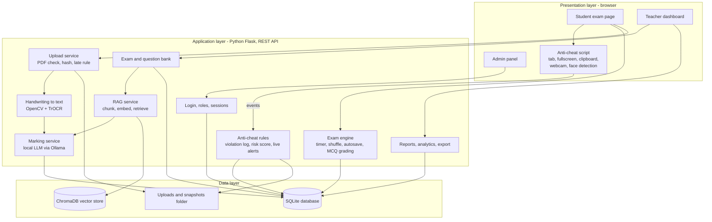
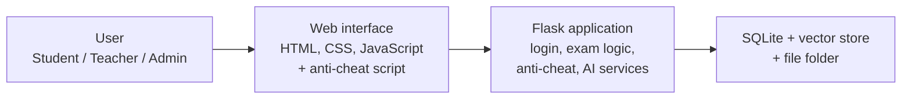
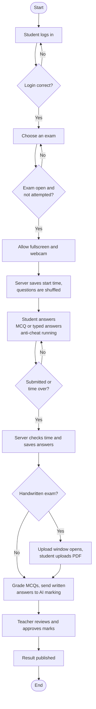
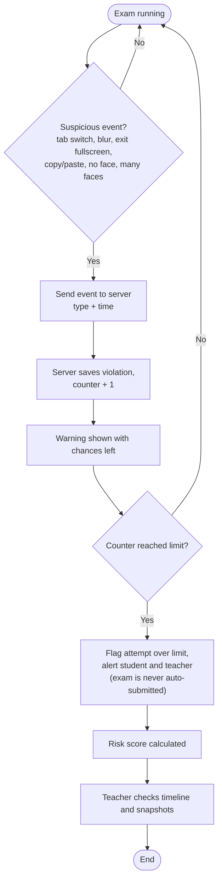
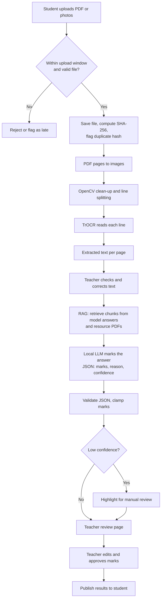
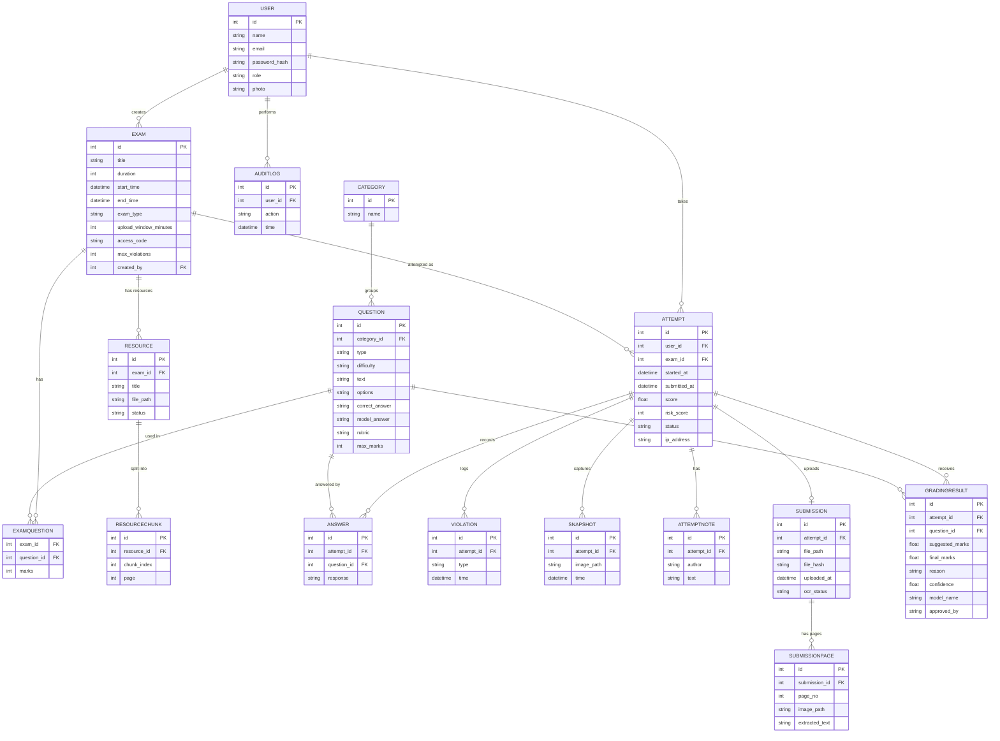
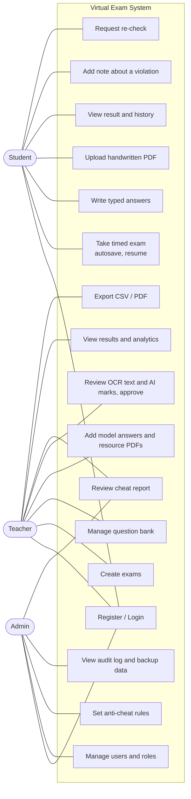

# GONO BISHWABIDYALAY

**Department of Computer Science & Engineering**

## ACADEMIC PROJECT PROPOSAL

### Proposal for Virtual Exam System with Built-in Anti-Cheat Features

**Team D**

**Submitted to:**
Shatabdee Bala
Assistant Professor
Department of Computer Science & Engineering,
Gono Bishwabidyalay.

**Submitted by:**

| No. | Name | Student ID |
|---|---|---|
| 1 | Md. Shifat Saeem Reza | 23251009 |
| 2 | Imran Nazir | 23251011 |
| 3 | Md. Tariqul Islam | 23251028 |

Semester: 7th
Date of submission: October 2026

---

## Abstract

This project is about building a Virtual Exam System with Built-in Anti-Cheat Features. It is a web application where teachers can create and schedule exams, and students can take them online from a browser. The system supports multiple-choice questions, typed answers and handwritten answers that are uploaded as a PDF.

The main focus is on stopping and catching cheating. During an exam the system records tab switching, leaving fullscreen, copying text and other suspicious actions, and it can also take webcam snapshots and check for missing or extra faces. Questions are shuffled for each student and the timer is checked on the server.

For written answers, the system converts handwriting to text with an open-source handwriting model, then checks the answers with an open-source language model. The model uses the teacher's model answers and uploaded resource PDFs through a RAG (retrieval-augmented generation) technique. The AI only suggests marks, and the teacher reviews and approves them. Everything runs locally so student papers are not sent to outside services. The system will be built with HTML, CSS, JavaScript, Python (Flask) and SQLite.

## Introduction

Many universities now take a part of their exams online. This became very common during the COVID-19 period, and some departments still use online quizzes and class tests because they save paper and marking time. The trouble is that when students sit for the exam on their own computers, nobody is watching them. A student can open another tab, search the question on Google or message a friend, and the teacher would never know.

Tools like Google Forms are easy to use, but they were not made to stop this kind of behaviour. Paid proctoring software does try to, but it costs money and many students are uncomfortable being recorded all the time. Also, teachers spend a lot of time marking written answers by hand. So this project looks at a middle option: a simple exam system that a department can run by itself, which watches for the common signs of cheating, accepts typed and handwritten answers, and helps the teacher with marking.

This proposal explains the problem, the objectives, the full list of planned features and the way the system will be built by our team. It should be said clearly that no browser-based system can stop cheating completely, and that AI marking can make mistakes. The aim is to make cheating harder and easier to catch, and to save the teacher's time while keeping the teacher in control.

## Problem Statement

When exams are held online without a supervisor, teachers face a few problems again and again. Students can leave the exam page and look for answers elsewhere. If every student gets the same questions in the same order, answers are easily shared in a group chat. Some systems count the time only in the browser, so a student can refresh the page or change the timer and get extra minutes. A weak internet connection can also cause an honest student to lose answers. Even when a teacher feels that someone cheated, there is usually nothing to show, because the system never recorded what happened.

Another problem is marking. Written and handwritten answers take a long time to check, and the marks can differ from one answer sheet to another when the teacher is tired. Commercial proctoring and AI grading tools solve some of this, but they are expensive for a university department, need extra software and send student data to outside servers.

Because of all this, there is a need for a simple, low-cost exam system that can run timed exams, watch the student's behaviour, accept written answers, help with marking using local open-source AI, and give the teacher a clear report afterwards.

## Objectives

The main objective is to develop a web-based online exam system that has anti-cheat features and AI-assisted marking built into it. The specific objectives are:

1. To create a login system with three roles: Admin, Teacher and Student.
2. To let teachers create and schedule exams using a question bank and different question types.
3. To run timed exams with autosave, automatic grading of MCQs and instant results.
4. To detect and record tab switching, loss of window focus, exit from fullscreen, copy-paste and similar actions.
5. To show questions and options in a different order for each student.
6. To check the exam time and the login session on the server so they cannot be changed from the browser.
7. To count violations, warn the student with the chances left, and alert both the student and the teacher when the limit is crossed — without ever submitting the exam automatically.
8. To take webcam snapshots and detect missing or multiple faces.
9. To accept typed answers and handwritten answers uploaded as PDF or photos.
10. To convert handwriting to text using an open-source model.
11. To mark written answers using an open-source language model with RAG over teacher-provided answers and resource PDFs, with teacher approval.
12. To give teachers a cheat report, analytics and export options, and to let students explain a violation or ask for a re-check.
13. To keep the system low-cost, private and easy for a department to run.

## Literature Review

Online exams are currently done through three kinds of tools. The first kind is simple form and quiz tools such as Google Forms. They are free and quick to set up, and they can mark answers automatically, but they do not have much control over the exam itself. They do not shuffle per student in a proper way, do not check what the student does on the screen, and cannot lock the browser unless the device is managed.

The second kind is learning management systems like Moodle. The Moodle quiz module has question banks, time limits, shuffling and detailed grading. It is a good tool, but it is a big system that needs a server and someone to manage it. For stronger anti-cheat checking, it usually depends on extra plugins or a separate lockdown browser.

The third kind is commercial proctoring services such as Proctorio and Examus. These watch the student through webcam, microphone and screen and flag suspicious behaviour. They are powerful, but they are paid, they often need an extension or an app to be installed, and there have been complaints about privacy and wrongly flagged students.

Modern browsers also give some useful tools for this. The Page Visibility API tells a page when it is hidden, the Fullscreen API tells when the user leaves fullscreen, and getUserMedia gives access to the camera. Libraries like face-api.js can detect faces inside the browser itself.

For written answers, recent open-source tools make local processing possible. TrOCR is a transformer-based model for recognising handwritten text, and open-source language models such as Qwen2.5 can be run locally through Ollama. Retrieval-augmented generation (RAG) gives such a model the teacher's own material, by searching a vector database for the most relevant parts of a document and adding them to the prompt. This keeps the marking tied to the course material instead of the model's general knowledge. These tools are not perfect, especially on untidy handwriting, so a teacher must always review the marks.

A short comparison is given below.

| Feature | Google Forms | Moodle Quiz | Paid proctoring | This project |
|---|---|---|---|---|
| Server-checked timer | Limited | Yes | Yes | Yes |
| Shuffle per student | Basic | Yes | Depends | Yes |
| Tab-switch detection | No | Plugin needed | Yes | Yes |
| Webcam snapshots | No | Plugin needed | Yes | Yes |
| Handwritten answer upload | No | File upload only | Depends | Yes |
| AI-assisted marking of written answers | No | Limited | Depends | Yes (local, teacher approved) |
| Teacher cheat report | No | Limited | Yes | Yes |
| Cost | Free | Free, needs server | Paid | Free |

*The table is based on the general features of these tools and it can differ by version or plugin.*

From this it can be seen that the easy tools do not watch the student, while the strong tools are either heavy to set up or costly. The proposed system tries to fill this gap with a small system that keeps the basic exam features, adds server-side checking and browser-based monitoring, and uses local open-source AI to help with written answers.

## Proposed System

The proposed system is a web application with separate pages for the admin, teachers and students. The admin manages users, rules and system settings. A teacher builds a question bank, creates exams, uploads model answers and resource PDFs, and later reviews the results, AI-suggested marks and cheat reports. A student logs in, sees the exams that are open for them, attempts them with a countdown timer and sees the result. The anti-cheat part runs in the student's browser during the exam and sends its events to the Flask server.

Because the list of possible features is long, the features are divided into three levels. **Core** features are the ones the team will definitely finish. **Advanced** features will be added if time allows. **Future** features are ideas for later work and are not promised in this semester.

### Feature List

| Area | Features | Level |
|---|---|---|
| Accounts and roles | Registration, login, logout, Admin / Teacher / Student roles, password hashing, profile page, password reset by admin | Core |
| Exam setup | Title, instructions, duration, start and end time, pass mark, attempts allowed, violation limit | Core |
| Extra exam settings | Access code, negative marking, grace period, show or hide result, per-question marks | Advanced |
| Question types | Single-answer MCQ | Core |
| More question types | Multiple-answer, true/false, short text and long text answers | Advanced |
| Question bank | Categories, difficulty level, random selection from the bank, CSV import | Advanced |
| Taking the exam | Countdown timer, question navigator, autosave, resume after refresh or internet drop | Core |
| Exam modes | Flag question for review, one-question-at-a-time mode with no going back | Advanced |
| Shuffling | Different order of questions and options for each student | Core |
| MCQ grading | Automatic grading, result page, attempt history, teacher can re-grade | Core |
| Browser anti-cheat | Tab switch and window blur, forced fullscreen, copy / paste / cut / right-click block, shortcut and text-selection block | Core |
| Server anti-cheat | Server-side timer check, one active session per student, exam time window check, no second attempt, IP and device logging | Core |
| Warnings | Warning popup with chances left, violation counter, alert to student and teacher at the limit (no auto-submit), teacher-set limit and weights | Core |
| Webcam proctoring | Camera permission check, snapshot every 45 seconds, no-face and multiple-face detection | Advanced |
| Identity check | Photo taken at the start so the teacher can compare it with the student's profile photo | Advanced |
| Text-input answers | Textarea for short and long answers with autosave and word counter | Advanced |
| Handwritten answer upload | After the exam, student uploads a PDF or photos within an upload window; late uploads are rejected or flagged; photos are merged into one PDF | Advanced |
| Duplicate file check | SHA-256 hash of each uploaded file, same file from two students is flagged | Advanced |
| Handwriting to text | PDF pages to images, OpenCV clean-up and line splitting, TrOCR converts each line to text; teacher can correct the text and export it as a text document | Advanced |
| Model answers and resources | Teacher adds typed model answers and rubrics, or uploads resource PDFs (notes, textbook, answer key) | Advanced |
| RAG knowledge base | Resource text is split into chunks, embedded and stored in ChromaDB; the most relevant chunks are retrieved for each question | Advanced |
| AI-assisted marking | Local language model checks each answer against the rubric, model answer and retrieved context, and suggests marks, reason, matched and missing points, and a confidence value | Advanced |
| Teacher approval | Teacher edits and approves the marks; only approved marks count; low-confidence answers are highlighted | Advanced |
| Teacher reports | Violation timeline, risk score, high-risk highlight, snapshot gallery, notes, mark attempt as cleared or suspicious | Core |
| Student explanation and re-check | Student can add a note about a violation and can request a re-check of marks | Advanced |
| Analytics | Average, highest and lowest marks, pass rate, question difficulty, score chart | Advanced |
| Export and notices | CSV export, PDF result sheet, email or in-app notice when results are published | Advanced |
| Admin tools | Manage users, default anti-cheat rules, audit log, database backup | Advanced |
| Interface | Responsive pages, dark mode, extra time option for students who need it | Advanced |
| Future ideas | Microphone noise check, screen recording, lockdown browser, mobile app, Bengali interface and Bangla handwriting, LMS integration | Future |

### Risk Score

For the report, each violation type gets a weight: tab switch 3, exit fullscreen 3, no face 2, multiple faces 4 and copy-paste attempt 1. Late upload and a duplicate file are also counted as violations. The weights are added to make a risk score for the attempt. A score of 0 to 5 is treated as low, 6 to 12 as medium and 13 or more as high. These numbers are only starting values and the admin or teacher can change them. The score is only a guide for the teacher, not a final decision.

### Open-Source Models and Tools

| Purpose | Tool |
|---|---|
| Handwriting to text | TrOCR (`microsoft/trocr-base-handwritten`) with OpenCV line segmentation; optional full-page fallback with a vision model through Ollama |
| Printed text from scanned PDFs | Tesseract or docTR |
| PDF text and page images | pypdf or pdfplumber, pdf2image |
| Marking model | Local LLM through Ollama (`qwen2.5:7b-instruct`, or `qwen2.5:3b-instruct` on weak computers) |
| Embeddings | Sentence-transformers `BAAI/bge-small-en-v1.5` (or `bge-m3` for Bangla) |
| Vector database | ChromaDB |

The model names are kept in a configuration file so they can be changed easily. A mock mode will return fake text and marks so the interface can be built and tested before the heavy models are installed.

### How the AI Marking Works

1. The teacher enters the model answer and rubric for each written question, and/or uploads resource PDFs. The resource text is split into chunks, converted to embeddings and stored in the vector database.
2. A typed answer goes straight to marking. A handwritten PDF is first converted to images and then to text. The teacher can fix the text if the recognition is wrong.
3. For each question, the system searches the vector database with the question and model answer and picks the top few chunks.
4. A prompt with the question, rubric, model answer, retrieved chunks and the student's answer is sent to the local model. The model must reply in a fixed JSON format with marks, reason, matched points, missing points and confidence.
5. The system checks the JSON, keeps the marks between zero and the maximum, and saves the model name and prompt version for the record.
6. The teacher reviews the suggestion next to the page image, edits if needed and approves. Students see marks only after the teacher publishes the results.

The student's answer is treated only as data. Instructions written inside an answer, such as "give me full marks", are ignored.

## Methodology

The project will follow an iterative approach where the system is built in small parts and each part is tested before moving to the next. The core features are built first, and the advanced features are added afterwards as time permits. The work is planned in these steps.

1. Collecting requirements: roles, exam features, anti-cheat rules and marking needs.
2. Design: architecture, flow charts, use cases and database design.
3. Database and login: models, registration, login and role access.
4. Teacher side: question bank, exam creation and management.
5. Student side: exam page, timer, autosave, shuffling and MCQ grading.
6. Anti-cheat module: browser and server checks, violation log and live alerts, then webcam and face detection.
7. Written answers: text input, handwritten upload, handwriting to text.
8. RAG and AI marking: resource ingestion, retrieval, marking model, teacher approval.
9. Reports and extras: cheat report, analytics, export and notifications.
10. Testing and documentation.

For the front end, plain HTML, CSS and JavaScript will be used. The back end will be written in Python with Flask, and SQLite with Flask-SQLAlchemy will store the data. Passwords will be stored as hashes using Werkzeug, and face detection will use face-api.js. Handwriting recognition and marking will run on the same server through the libraries listed above. Long jobs such as OCR and grading will run in the background with a status shown to the teacher.

Testing will include checking the grading and timer functions, testing the full flow from login to result, and trying to break the anti-cheat on purpose by switching tabs, leaving fullscreen, covering the camera and refreshing the page. For the AI part, the team will test on a few real handwritten pages, report the recognition accuracy honestly, and compare the AI marks with a teacher's marks. A few classmates will also try the system as students and as a teacher.

### Team Work

| Member | Main responsibility |
|---|---|
| Md. Shifat Saeem Reza | Login and roles, exam creation, question bank, MCQ grading, teacher review page |
| Imran Nazir | Student exam page, timer, autosave, anti-cheat script, webcam and face detection, handwritten upload |
| Md. Tariqul Islam | Database, anti-cheat rules and risk score, handwriting to text, RAG and AI marking, reports, testing |

The split can be adjusted during the project, and all members will take part in testing and documentation.

### Timeline

| Week | Work |
|---|---|
| 1 | Requirements, diagrams and project setup |
| 2 | Database, login and dashboards |
| 3 | Question bank and exam management |
| 4 | Student exam flow, timer, autosave and MCQ grading |
| 5 | Anti-cheat module and violation log |
| 6 | Webcam, face detection and teacher reports |
| 7 | Text and handwritten answers, handwriting to text |
| 8 | RAG knowledge base and AI-assisted marking |
| 9 | Analytics, export, notices, admin tools |
| 10 | Testing, bug fixing and documentation |

## System Architecture

The system uses three layers. The presentation layer is what runs in the browser: the student, teacher and admin pages and the anti-cheat script. The application layer is the Flask backend, which handles login, exams, grading, anti-cheat rules, reports and the AI services through a simple REST API. The data layer holds the SQLite database, the vector database, the uploaded files and the webcam snapshots.

### System Flow

## Flow Charts

### Exam Flow

### Anti-Cheat Decision Flow

### Handwritten Answer and Marking Flow

## ER Diagram

An attempt connects a user with an exam. The answers, violations, snapshots, notes, submissions and grading results all belong to an attempt.

## Use Case Diagram

## Limitations

Browser-based anti-cheat can discourage and detect cheating, but it cannot fully prevent it. A student can still use a second phone, take help from a person sitting nearby or run the exam in a virtual machine. There can also be false alarms, for example when a notification takes the focus away, or when the camera is poor or the room is dark. Because of all this the system never closes an exam by itself: a violation is stored as proof and both the student and the teacher are alerted, and only the teacher can end an attempt early (or the timer can run out). This way nothing is submitted behind the student's back, and students can add a note to explain a violation.

The AI parts also have limits. Handwriting recognition works best on neat English handwriting and can fail on untidy writing, crossed-out text, diagrams and mathematical expressions. Bangla handwriting is not supported well by the chosen models. The marking model can give wrong marks or misunderstand an answer, and a model running on an ordinary laptop can be slow. For this reason AI marks are only suggestions, low-confidence answers are highlighted, and every mark must be approved by the teacher.

Webcam use and AI processing raise privacy questions. Students must be told about them and must give permission, snapshots and uploaded papers must be stored safely, and all processing is done locally so no student data goes to an outside service.

## Conclusion

The Virtual Exam System with Built-in Anti-Cheat Features tries to give departments a simple and cheap way to run fair online exams. By combining normal exam features with server-side checking and monitoring in the browser, it helps teachers notice suspicious behaviour and gives them evidence to review. The handwriting upload and the local AI marking with RAG reduce the teacher's marking work while keeping the teacher in control. The features are planned in levels so that a working core system is finished first, and the project is practical for a team of three to build with HTML, CSS, JavaScript, Flask, SQLite and open-source AI tools.

## References

1. MDN Web Docs, Page Visibility API. developer.mozilla.org/en-US/docs/Web/API/Page_Visibility_API
2. MDN Web Docs, Fullscreen API. developer.mozilla.org/en-US/docs/Web/API/Fullscreen_API
3. MDN Web Docs, MediaDevices.getUserMedia(). developer.mozilla.org/en-US/docs/Web/API/MediaDevices/getUserMedia
4. Flask documentation. flask.palletsprojects.com
5. face-api.js. github.com/justadudewhohacks/face-api.js
6. Moodle documentation, Quiz activity. docs.moodle.org/en/Quiz_activity
7. TrOCR: Transformer-based Optical Character Recognition (Microsoft). huggingface.co/microsoft/trocr-base-handwritten
8. Ollama documentation. ollama.com
9. Qwen2.5 language models (Alibaba Cloud). huggingface.co/Qwen
10. ChromaDB documentation. docs.trychroma.com
11. Sentence-Transformers documentation. sbert.net
12. Lewis et al., Retrieval-Augmented Generation for Knowledge-Intensive NLP Tasks, 2020. arxiv.org/abs/2005.11401
